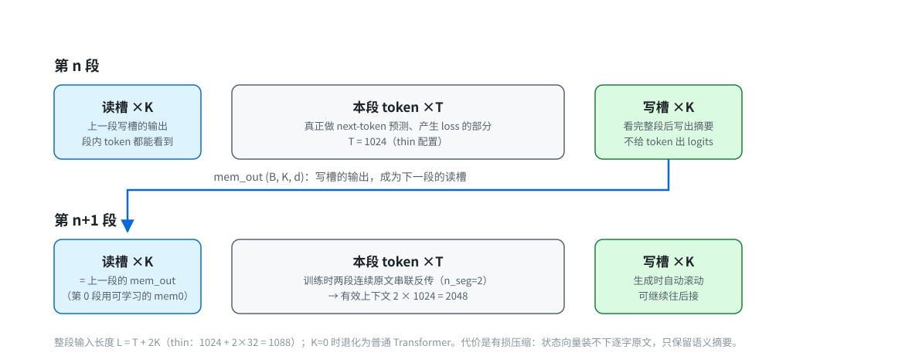

# miniNLM

从零训练的中文小说语言模型：46M 参数、7.2B token、单卡 16GB（AMD RX 9060 XT / WSL2 + ROCm）约 118 GPU 小时跑完。
训练框架、模型结构、数据管线、SFT、推理全部手写，无第三方训练框架依赖（只有 `torch` + `sentencepiece`）。

<p align="center">
  
  
  
  
  
  
</p>

> **English**: miniNLM is a from-scratch Chinese language model (46M params, thin 18×384 Transformer, 48k BPE)
> pretrained on 7.2B tokens of Chinese web novels, trained end-to-end on a single 16 GB consumer GPU
> (RX 9060 XT, WSL2 + ROCm) in ~118 GPU-hours. It ships its own data pipeline, a memory-slot mechanism
> for long context, KV-cache decoding, and a masked-loss SFT pipeline. Code is MIT; the corpus is not
> redistributed.

| 指标 | 值 |
|---|---|
| 模型 | `thin`：18 层 × d384 × 8 头，GQA(2 KV 头)，QK-Norm，z-loss，46.3M 参数（非嵌入 27.9M） |
| 数据 | 6951 本中文网络小说 → 7.20B 训练 token / 0.41B 验证 token，48k BPE（1.666 字/token） |
| 训练 | 146,473 步 × 49,152 token，约 2.9 s/步 ≈ 17.5k tok/s，累计 **≈118 GPU 小时（5 天）** |
| 结果 | `val_loss 4.0726` / `ppl 58.6`（训练协议）；独立复核 600 批 → `4.0576 ± 0.014` / `ppl 57.8` |
| 生成 | 约 80 token/s（bf16，KV cache），有效上下文 2048（32 记忆槽 × 2 段） |

---

## 样例输出

`ckpt_best.pt` 的真实采样（`temperature 0.75` / `top_k 40` / `repetition_penalty 1.15`）。未编辑，只在第一个合适的句号处截断：

**提示词** `他推开门的瞬间，房间里弥漫着淡淡的血腥味。`

```text
他推开门的瞬间，房间里弥漫着淡淡的血腥味。
“进来！”一个威严的声音响起，门吱呀一声推开，林牧带着杨帆和聂云飞走了进去。
“你们这是？”聂云飞愣了一下，然后看向李强，一脸震惊。
李强脸上有难以掩饰的惊讶之色，道：“林、林大人，您终于出来了。”
“你真的是林大人？”聂云飞一脸激动的看着李强，眼睛都有点湿润了。
```

引号、分行、`道：` 这类对话格式是它学得最好的部分；再往后写两三句就会开始绕圈，这是 46M 参数的容量上限。
更多提示词和「怎么读这些样例」：[examples/samples.md](examples/samples.md)。

---

## 特性

- **纯手写 Transformer**：RoPE + RMSNorm + SwiGLU + 权重绑定，手写因果注意力（ROCm 上 SDPA 只有 MATH 后端，手算更快）。
- **记忆槽（memory slots）**：在每段 token 两侧各挂 32 个可学习的「读写槽」，把固定 1024 上下文扩展到不限长度；段内每个 token 都能读到历史摘要，段尾写槽回写。实测在第二段上 loss 比冷启动低 **0.096**。
- **长上下文训练**：`--n_seg 2` 把两段连续原文串联反传（BPTT），有效上下文 2048。
- **现代小模型技巧**：GQA、QK-Norm、z-loss、`torch.compile`（1.9×）、原子写检查点、断点续训、完成标记。
- **数据管线**：HF 原始 jsonl → 清洗（广告/目录/重复章）→ sentencepiece 训练 → 打包成 `uint16` 流，全流程可复现。
- **KV cache 推理**：`chat.py` 交互式续写（滚动上下文、候选挑选、撤销、自动跟随新检查点）。
- **SFT**：`sft_data.py` + `sft.py`，loss 只算「助手：」之后的回答（mask），附 `ask.py` 对话入口与完整实验记录。

## 快速开始

```bash
git clone <this-repo> && cd miniNLM
pip install -r requirements.txt          # ROCm 见文件内注释

# 1) 准备数据（自己造，或按 docs/data.md 的全流程重建）
#    期望 data_v4/ 下有 train.bin / val.bin / spm48k_v4.model / meta.json

# 2) 预训练（单卡 16GB 默认配置）
python train.py --data_dir data_v4 --out_dir out \
    --preset thin --n_kv_head 2 --qk_norm 1 --z_loss 1e-4 \
    --batch_size 4 --grad_accum 6 --warmup 500

# 3) 采样 / 交互续写
python sample.py --ckpt out/ckpt_best.pt --prompt "第1章 边陲" --n 300
python chat.py   --ckpt out/ckpt_best.pt

# 4) SFT（可选）
python sft_data.py --in examples/demo_sft.jsonl --out_dir data_sft
python sft.py --sft_dir data_sft --init out/ckpt_best.pt --out_dir out_sft --steps 120 --lr 3e-5
python ask.py --ckpt out_sft/ckpt_sft_best.pt --q "你好，你是谁？"
```

> 检查点（185–556 MB）与数据（几十 GB）不在仓库里，见 `.gitignore`。没有 `data_v4/` 时任何脚本都会直接报错退出，不会静默跑错数据。

## 模型配置

`--preset` 见 `train.py:PRESETS`：

| preset | 层 | d | 头 | 宽/深 | 参数量（48k 词表） | 1 epoch |
|---|---|---|---|---|---|---|
| `small` | 6 | 384 | 6 | 64 | 27.9 M（非嵌入 9.5 M） | — |
| `base`（默认） | 8 | 512 | 8 | 64 | 47.2 M（非嵌入 22.6 M） | 81 h |
| `wide` | 6 | 640 | 8 | 107 | 56.8 M（非嵌入 26.1 M） | — |
| `deep` | 16 | 512 | 8 | 32 | 69.7 M（非嵌入 45.1 M） | — |
| **`thin`**（本项目） | 18 | 384 | 8 | 21 | **46.3 M（非嵌入 27.9 M）** | 117 h |
| `thin30` | 30 | 320 | 8 | 11 | 48.9 M（非嵌入 33.5 M） | — |

实测速度（RX 9060 XT 16 GB，bs4×accum6×1024×2 = 49,152 token/步）：

| preset | 编译 | 秒/步 | tok/s |
|---|---|---|---|
| `base` 8×512 | 50 s | 2.00 | 24.6k |
| `thin` 18×384 | 6 min | 2.88 | 17.1k |

换 preset 等于换架构，**不能 `--resume` 别的 preset 的检查点**。查全部配置：`python tools/check_presets.py [--preset thin] [--run]`。

## 记忆槽（`--n_mem 32`）



每段输入变成 `[读槽 32][本段 1024 token][写槽 32]`，总长 1088：

- 读槽 = 上一段写槽的输出，段内所有 token 因果地看到它们 → 读到历史；
- 写槽排在段尾，看完整段后写出摘要 → 写回历史；
- 生成时自动滚动，理论上可无限续写；`--n_mem 0` 退化成原始 Transformer（检查点互不兼容）。

代价是**有损压缩**：状态向量装不下逐字原文，只保留语义摘要。额外开销 <3%。

## 仓库结构

```
model.py            模型定义（GPT + 记忆槽 + KV cache + generate）
train.py            预训练（bf16/AdamW/余弦退火/梯度累积/torch.compile/断点续训）
sample.py           命令行采样
chat.py             交互式续写 REPL（滚动上下文、候选、撤销、热加载）
sft_data.py         对话数据 → token 流 + loss mask
sft.py              masked-loss SFT（从预训练权重出发）
ask.py              按「用户/助手」格式对话
eval_val.py         独立复算验证集 loss/ppl（带置信区间、分段诊断）
gen_samples.py      固定提示词批量采样，落盘成 markdown 对比
fit_curve.py        从 log.csv 拟合学习曲线、外推更大训练量
examples/           示例 SFT 数据 + 采样样例（samples.md）
scripts/            无人值守训练（看护循环 / 优雅停止 / systemd unit）
tools/              数据管线、基准测试、诊断脚本（legacy/ 是历史版本）
tests/              CPU 冒烟测试（前向/反向/mask/记忆槽/KV cache，不需要数据与权重）
docs/               架构评审、小模型调研、训练配方、SFT 指南、实验记录
docs/assets/        文档配图（记忆槽示意图等）
.github/workflows/  CI（CPU torch：语法 + 冒烟测试 + preset + CLI 自检）
```

## 文档

| 文档 | 内容 |
|---|---|
| [docs/data.md](docs/data.md) | 数据从 HF 原始分片到 `train.bin` 的全流程与验收指标 |
| [docs/sft-guide.md](docs/sft-guide.md) | SFT 原理、mask 机制、三轮实验（含踩坑） |
| [docs/experiments.md](docs/experiments.md) | 预训练与 SFT 的实验记录、消融与数字 |
| [docs/arch-review.md](docs/arch-review.md) | 架构体检：FLOPs 分解、解码瓶颈、可加入的论文改进 |
| [docs/small-model-survey.md](docs/small-model-survey.md) | <100M 小模型横向调研（SmolLM2 / Qwen3 / MobileLLM） |
| [docs/training-recipe.md](docs/training-recipe.md) | 学习率调度、embedding 不衰减、权重平均等配方的文献证据 |
| [docs/runbook.md](docs/runbook.md) | 无人值守训练：断电自愈、优雅停止、任务计划 |
| [examples/samples.md](examples/samples.md) | 真实采样样例与「怎么读这些样例」 |

## 开发

```bash
python tests/smoke_test.py        # CPU 冒烟测试：不需要数据文件，也不需要权重，几秒钟跑完
python tools/check_presets.py     # 打印各 preset 的参数量 / FLOPs / 速度
python chat.py --selftest         # 命令行解析与异常输入的边界检查
```

CI（`.github/workflows/ci.yml`）在 Ubuntu + CPU 版 torch 上跑上面三项，外加 `compileall`、`bash -n` 和各入口的 `--help`，
Python 3.10 与 3.12 各一遍，不需要 GPU。推送仓库后可以在 **Actions** 页看到结果；想要徽章就把下面一行加到标题下方，
记得把 `<OWNER>/<REPO>` 换成实际地址：

```markdown
[](https://github.com/<OWNER>/<REPO>/actions/workflows/ci.yml)
```

## 数据来源与许可

- 语料来自 HuggingFace [`wdndev/webnovel-chinese`](https://huggingface.co/datasets/wdndev/webnovel-chinese)（39 GB jsonl，一行一章）。清洗后 6951 本、127.94 亿字、448 万章。
- **原始文本与 token 流不随仓库分发**（体积 + 版权原因）；`tools/dl_hf.py` 可重新下载，`docs/data.md` 有完整复现步骤。
- 代码 MIT。模型权重若发布，其上承载的文本内容仍受原数据集许可约束。

## 已知限制

- 46M 参数 + 网文语料：会写「网文腔」，但知识面窄、容易绕圈、2–3 句后跑题；温度 0.7–0.8 比 0.9 稳。
- 贪心/极低温解码容易掉进重复循环，建议 `temperature 0.75 / top_k 40 / rep_penalty 1.15`。
- SFT 只到「学会对话格式」的程度：25 条指令数据远不够，见 `docs/sft-guide.md` 的结论。
- 显存吃满会让同卡输出桌面的 Windows 卡顿，`--mem_frac` 默认 0.85，白天建议 0.6。
- `LoadLib(libhsa-amd-aqlprofile64.so) failed` 是 ROCm 良性告警，可忽略。
